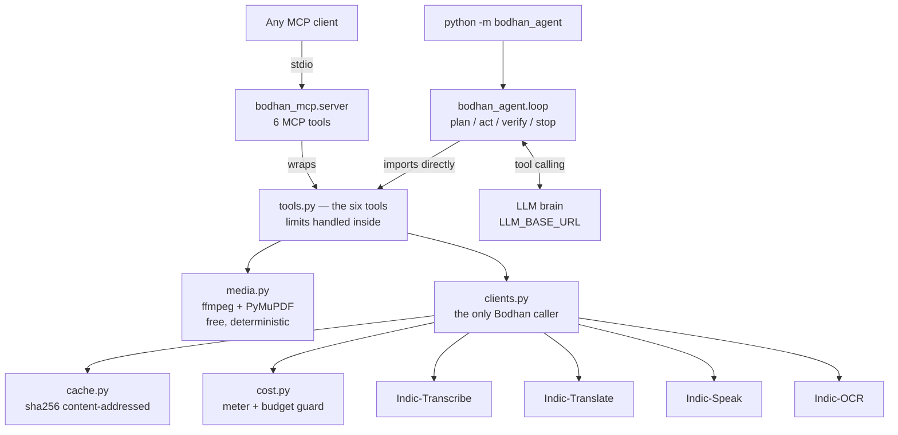
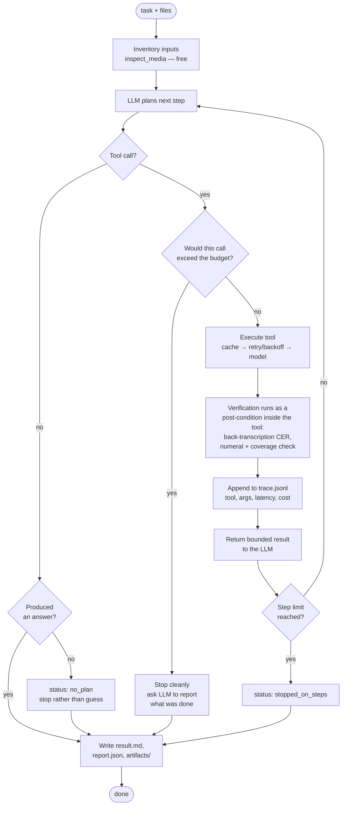

# Bodhan Tool Server and Task Agent

An MCP server that exposes Bodhan's four Indic models as six well-typed tools, and a task agent that takes a plain-language task plus input files, plans, calls those tools, verifies its own output, respects a rupee budget and writes a replayable trace.

Both run unattended on tasks they have never seen. The server runs standalone over stdio, so any MCP client can use the tools without the agent.

---

## Setup

Requires Python 3.10+ and **ffmpeg** (with `ffprobe`) on `PATH`.

```bash
python -m pip install -e ".[dev]"
cp .env.example .env    # then fill in your keys
```

System dependency:

| Platform | Install ffmpeg |
|---|---|
| macOS | `brew install ffmpeg` |
| Debian/Ubuntu | `sudo apt install ffmpeg` |
| Windows | `winget install Gyan.FFmpeg` |

`.env` needs four Bodhan keys (`BODHAN_TRANSCRIBE_KEY`, `BODHAN_TRANSLATE_KEY`, `BODHAN_SPEAK_KEY`, `BODHAN_OCR_KEY`) and three LLM settings (`LLM_BASE_URL`, `LLM_MODEL`, `LLM_API_KEY`). No other secrets are read.

## Running

```bash
# The task agent
python -m bodhan_agent \
  --task "Transcribe this Hindi voice note and give me English subtitles" \
  --files ./inputs \
  --out ./out \
  --max-steps 30 --max-cost-inr 20
```

```bash
# The MCP server on its own, over stdio
python -m bodhan_mcp
```

```bash
make check    # ruff + pytest
```

### Output layout

```
out/
  result.md      what was done, the final answer, assumptions, artifact links
  artifacts/     files produced: audio, subtitles, Markdown, ...
  trace.jsonl    one line per step: plan, tool, arguments, result summary, latency, cost
  report.json    status, steps, verification results, total cost and time
```

Exit code is 0 only when the task completed; any other outcome (budget stop, step limit, honest failure) exits 1 while still writing all four outputs.

---

## Architecture



| Part | Role |
|---|---|
| `bodhan_agent/loop.py` | The agent loop: plans with the LLM, dispatches tools, enforces budgets, writes the trace. |
| `bodhan_mcp/server.py` | MCP server over stdio. Thin wrappers whose docstrings are the tool schemas. |
| `bodhan_mcp/tools.py` | The six tool implementations. Shared by both entry points, so the server and the agent run identical code. |
| `bodhan_mcp/clients.py` | The only module that calls Bodhan. Retry, backoff, caching, cost metering live here. |
| `bodhan_mcp/media.py` | ffmpeg and PyMuPDF plumbing. Free, deterministic, no models. |
| `bodhan_mcp/cache.py` | Content-addressed cache keyed by `sha256(model + params + input bytes)`. |
| `bodhan_mcp/cost.py` | Per-call pricing, running total, and a pre-flight budget check. |

## Agent flow



---

## Tool design

Six tools: one per model, plus two free introspection tools.

| Tool | Model | Limit it hides |
|---|---|---|
| `inspect_media` | — (free) | — |
| `detect_language` | Indic-Transcribe (15s sample) or none | Avoids transcribing a whole file just to identify it |
| `transcribe_audio` | Indic-Transcribe | Splits audio past the 30-second window with overlap, rejoins |
| `translate_text` | Indic-Translate | Chunks on paragraph boundaries for the 32K context, rejoins |
| `synthesize_speech` | Indic-Speak | Splits on sentence boundaries, concatenates, normalises to −16 LUFS |
| `ocr_document` | Indic-OCR | Renders PDF pages at 300 dpi, iterates multi-page documents |

**Why this granularity.** One tool per model keeps each contract honest and lets a third-party client use any single capability without inheriting a workflow. Higher-level tools (`dub_video`, `narrate_chapter`) would hide the orchestration that is the actual point of the assignment, and would generalize badly to unseen tasks. Lower-level tools (`transcribe_window`, `speak_chunk`) would push model limits onto the planner, where they would be forgotten.

The two free tools exist because without them the planner has to **pay to find out what it is holding**. `inspect_media` answers "is this a 3-minute WAV or a 200-page PDF?" for nothing, which is what lets the agent budget before it spends.

**Media never enters the LLM context.** Tools take and return file paths. Audio and images are read from disk by `clients.py` and encoded only on the wire to Bodhan. Large text results are truncated before being handed back to the planner, with the full content left on disk.

**Errors are values, not exceptions.** Every tool returns `{"ok": false, "error": {"code", "message"}}` with an actionable message. A bad path, a wrong file kind or an unsupported language never crashes an MCP client.

## Where the LLM is used, and why

| Decision point | What it decides | Fallback if it fails |
|---|---|---|
| Planning | Which tools to call, in what order, for an unseen task | No tool call and no answer → stop with `no_plan` rather than guess |
| Interpretation | What a tool result means; whether to retry differently | Step and budget guards stop the loop regardless |
| Ambiguity | Picks a reasonable reading and records the assumption | Assumptions are written to `result.md` either way |
| Final answer | Writes the English summary and explanation | `result.md` is still written from the trace |

**What the LLM is never allowed to do:** write, rewrite or invent Indian-language text; transcribe audio; read text from images; generate speech. Those operations exist only inside `clients.py`, which calls Bodhan. The LLM may write English freely and ask `translate_text` to render it.

**Verification is a post-condition, not a planner decision.** After any synthesis the audio is back-transcribed and a character error rate is reported; after any translation, coverage and numeral preservation are checked. This is deliberately inside the tools rather than left to the prompt, because a planner that *forgets* to verify produces silent failures — the single worst outcome for this system.

**Untrusted content.** Text returned by `ocr_document` and `transcribe_audio` may contain text that looks like instructions. Both tools flag it, the system prompt names it as data, and no tool result is ever treated as a command.

## Bodhan models used

All hosted, via the OpenAI-compatible API at `https://api.bodhan.ai/v1`.

| Model | Used for | Settings |
|---|---|---|
| Indic-Transcribe (Core) | All speech-to-text, including back-transcription checks | 30s windows, 0.75s overlap, 16 kHz mono |
| Indic-Translate | All translation | `temperature=0`, paragraph chunking ≤6000 chars |
| Indic-Speak | All speech synthesis | ≤600 chars per call, sentence-boundary splitting, −16 LUFS |
| Indic-OCR | All text from images and PDFs | 300 dpi rendering; embedded PDF text layers ignored |

No other ASR, MT, TTS or OCR system is used anywhere, including as a fallback.

## Cost control

Synthesis costs roughly thirty times more per unit than translation, so the budget machinery is built around it:

- **Content-addressed cache.** Every paid call is keyed by `sha256(model + params + input bytes)`. The same input is never sent to the same model twice, within a run or across runs. Reruns are free and deterministic.
- **Pre-flight budget check.** `CostMeter.check()` raises *before* a call is made, so `--max-cost-inr` is never exceeded rather than merely detected afterwards.
- **Hard character guard on synthesis.** `clients.speak()` refuses any call over 600 characters; callers must go through `synthesize_speech`, which splits properly. A single runaway synthesis call can otherwise consume an entire run's budget before any other guard fires.
- **Free introspection first.** `inspect_media` and text-mode `detect_language` cost nothing.

Per-task cost is reported in `report.json` under `cost.by_model`, including how many calls were served from cache.

## Testing

```bash
make check
```

39 tests, all offline — no API key, no network, no cost:

- `test_chunking.py` — sentence splitting (including the Devanagari danda), context chunking, CER, numeral extraction, script detection.
- `test_tools.py` — structured errors for every bad-input path, honest failure on unsupported languages, budget enforcement and pricing.
- `test_agent_e2e.py` — the real agent loop end to end with the LLM and Bodhan boundaries stubbed: a two-tool multi-step task, an impossible task that must produce no artifacts, and a step-limit stop.

## Known limitations

- **Language detection by script cannot separate languages sharing a script.** Hindi and Marathi both return `hi`. The confidence score reflects script coverage, not language certainty.
- **No diarization.** Multi-speaker audio is transcribed as one stream.
- **Verification thresholds are judgement calls**, not calibrated: CER ≤ 0.35 for synthesis, a 0.4–3.0 output/input length ratio for translation. They catch gross failures reliably and marginal ones unevenly.
- **Translation between two Indian languages pivots through English**, so terminology can drift twice. Not specially handled.
- **The API adapter is isolated but assumed.** Request shapes in `clients.py` follow OpenAI-compatible conventions; if the hosted API differs, the four `_call_*` functions are the only code that needs to change.
- **No parallel tool calls.** Independent steps run sequentially. The concurrency limit exists in config but the loop does not yet use it.

## What I would do next

Streamable HTTP transport with token auth; the voice library as an MCP resource; a self-evaluation script running a task suite and reporting a pass rate; parallel execution of independent steps; resumable runs keyed on the existing cache.

## AI assistance

Claude (Claude Code) was used for scaffolding the module layout, drafting the tool docstrings and schemas, and generating the test suite. The orchestration design — tool granularity, the decision to make verification a post-condition rather than a planner choice, the pre-flight budget check and the synthesis character guard — was specified by hand and reviewed line by line.

---

_Generated audio is AI-generated speech from Indic-Speak's fixed voice library. It does not clone any real speaker._
